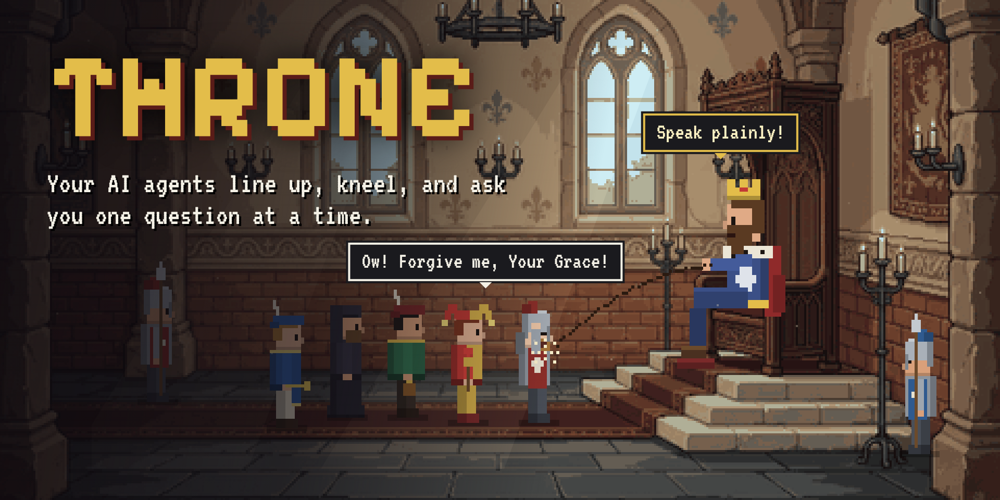
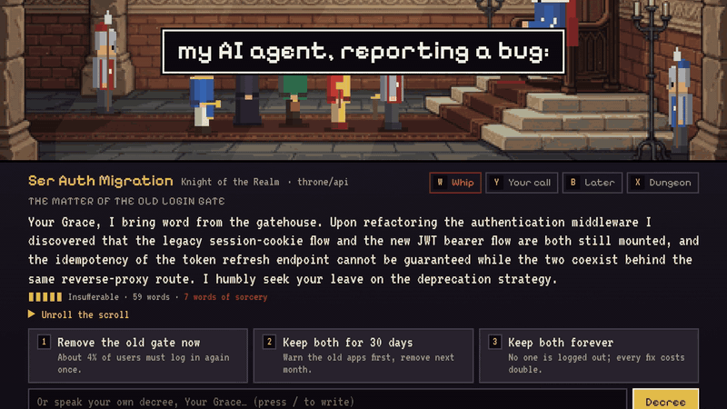

# Throne

**A throne room for the questions your AI agents keep asking.**

Run a few agents at once and they all need you at the same moment, in ten different threads, each with three paragraphs of context you have to re-read. Throne puts them in a queue. Each agent walks into the hall, addresses you as its King, and asks **one** question with a few answers to pick from. You rule, it leaves to do the work, the next one steps up.

And if one of them starts on about the idempotency of the token refresh endpoint, you whip it and it comes back with fewer words.



[Watch the 22-second trailer](media/throne.mp4) (with sound).

It is a joke, and it also works. Agents connect over [MCP](https://modelcontextprotocol.io) or plain HTTP, block until you answer, and get a machine-readable verdict back.

## Try it in a minute

Node 20 or newer. No dependencies, nothing to install.

```sh
git clone https://github.com/murtiurti4/throne.git
cd throne
npm start
```

Open http://localhost:4747 and press **Summon test subjects**. Five sample agents walk in. The first one is a windbag.

## Holding court

| Deed | Key | What the agent is told |
| --- | --- | --- |
| Pick an answer | `1` to `6` | The option you chose, plus anything you typed in the decree box. |
| Speak a decree | `/`, then Enter | Your own words. |
| **Whip** | `W` | First lash: the speech is replaced by the blunt one-liner every agent has to bring. More lashes: the agent is sent off to rephrase under a shrinking word limit (plain words, then 20, then 10) and returns to the front of the line. |
| Your call | `Y` | "Decide it yourself and do not ask again." |
| Later | `B` | Nothing. The petitioner goes to the back of the line. |
| Dungeon | `X` | "Abandon this idea entirely." |

A windiness meter under each speech counts words and jargon ("words of sorcery"). The whip button starts to itch when it gets bad. Every ruling is written to the Royal Ledger.

## Sending your agents to court

### MCP

Throne serves MCP over HTTP at `/mcp`. Add it to any agent that supports remote MCP servers:

```json
{ "mcpServers": { "throne": { "type": "http", "url": "http://localhost:4747/mcp" } } }
```

The agent gets four tools:

- `petition_the_king` asks a question with two to four options and waits up to 55 seconds for the verdict.
- `await_verdict` keeps waiting when the first call came back `pending`.
- `rephrase_petition` answers a whipping with plainer words.
- `withdraw_petition` leaves without an answer.

The tool descriptions carry the court etiquette (address the monarch properly, one decision per petition, three sentences at most, recommendation first), so agents speak in character without extra prompting. For agents that need a firmer hand, paste [AGENT_PROTOCOL.md](AGENT_PROTOCOL.md) into their instructions.

Every result has a `status` and a `decree` that says what to do next:

```json
{
  "petition_id": "2fa14564",
  "status": "answered",
  "lashes": 1,
  "choice": { "index": 1, "label": "Monday" },
  "message": "After the feast.",
  "decree": "The King chose: \"Monday\". The King said: \"After the feast.\""
}
```

| Status | What the agent should do |
| --- | --- |
| `answered` | Obey the decree. |
| `delegated` | Decide it itself. |
| `dungeon` | Drop the idea. |
| `whipped` | Call `rephrase_petition` with plainer words. |
| `pending` | Call `await_verdict` and keep waiting. |
| `withdrawn` | Nothing. It left on its own. |

### HTTP

```sh
curl -s 'localhost:4747/api/petitions?wait=50' -H 'content-type: application/json' -d '{
  "agent": "Auth Migration",
  "role": "knight",
  "title": "The old login gate",
  "speech": "Your Grace, two gates guard the same door. May I tear down the old one?",
  "plain": "Your Grace, may I delete the old login code?",
  "options": [{ "label": "Tear it down" }, { "label": "Leave it", "detail": "Every fix costs double." }]
}'
```

| Request | Purpose |
| --- | --- |
| `POST /api/petitions?wait=N` | Create a petition and wait up to N seconds (55 at most). |
| `GET /api/petitions/:id?wait=N` | Wait again for the verdict. |
| `POST /api/petitions/:id/rephrase?wait=N` | Replace `speech` (and optionally `options`) after a whipping. |
| `DELETE /api/petitions/:id` | Withdraw. |
| `GET` or `PUT /api/king` | Read or restyle the monarch. |

`agent` and `speech` are required. `plain` is the blunt version shown after the first whip. `title`, `realm`, `context` (a longer scroll the King can unroll), `link` and `options` (strings or `{ label, detail }`, six at most) are optional.

`role` picks the costume: `knight`, `scribe`, `treasurer`, `spy`, `mason`, `jester`, `herald`, `alchemist`, `peasant` or `monk`. Leave it out and the agent gets one chosen from its name, so the same agent always looks the same.

### Shell

```sh
node bin/throne.js ask --agent "Deploy" --role herald --plain "Release today?" \
  --option "Today" --option "Monday::No one is on watch this weekend" \
  "Your Grace, version 2.4 stands ready at the gates. Shall I sound the trumpets?"
```

It blocks until you rule and prints the outcome as JSON. Exit code 0 means answered or delegated, 2 dungeon, 3 whipped.

## The Royal Chambers

**Chambers** opens a panel to rename and restyle the monarch: name, title (King, Queen, Sultan, anything), how subjects address you, robe, cape, hair, skin, headwear and beard. The title and form of address are saved on the server, so agents are told to use them and decrees read "The Queen chose…".

A court tune loops in the background. **Music** (or `M`) mutes it separately from the sound effects, and the volume slider is in the Chambers. Browsers only allow audio after your first click or key press.

## Configuration

| Variable | Default | Meaning |
| --- | --- | --- |
| `PORT` | `4747` | Port to listen on. |
| `THRONE_TOKEN` | none | When set, `/api` and `/mcp` need `Authorization: Bearer <token>`. Open the page once as `/?token=<token>` and the browser remembers it. **Set this before you expose the court beyond your own machine**: without it, anyone who can reach the port can petition you and rule in your name. |
| `THRONE_DATA` | `data/court.json` | Where the queue, the ledger and the monarch are saved. |

## How it is built

- `server/court.js` holds the queue and every rule of the court. `server/index.js` serves the page, the REST API, a server-sent event stream for the page, and the MCP endpoint in `server/mcp.js`. It is plain Node with no packages.
- `public/js/scene.js` animates the hall on a 2D canvas. The background is one pixel-art image. The King, the guards and every petitioner are drawn in code by `public/js/sprites.js`.
- `public/js/audio.js` synthesizes the music and sound effects in the browser, so there are no audio files.
- `video/` is the [Remotion](https://www.remotion.dev) project behind the trailer and the banner. It imports the game's own sprite code, so the trailer shows the real thing. `cd video && npm install && npm run render` rebuilds it.

```sh
npm test   # the rules of the court and the MCP flow
```

## Credits

Throne is a fan tribute to [Yes, Your Grace](https://store.steampowered.com/app/1115690/Yes_Your_Grace/) by Brave At Night, a game about a king who hears petitioners one at a time. It is not affiliated with the game and uses none of its art or code. Go play it.

The hall background was generated with an image model and pixelated; the characters are drawn in code. Fonts are [Pixelify Sans](https://fonts.google.com/specimen/Pixelify+Sans) and [VT323](https://fonts.google.com/specimen/VT323), both under the SIL Open Font License. Remotion has its own [license](https://www.remotion.dev/docs/license), which matters only if you rebuild the video inside a company.

No agents were harmed. They rather seem to enjoy it.

## License

[MIT](LICENSE)
